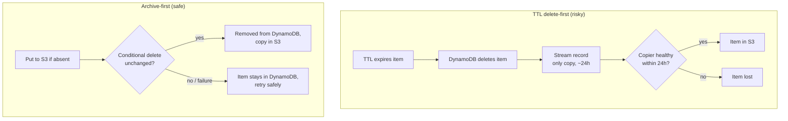
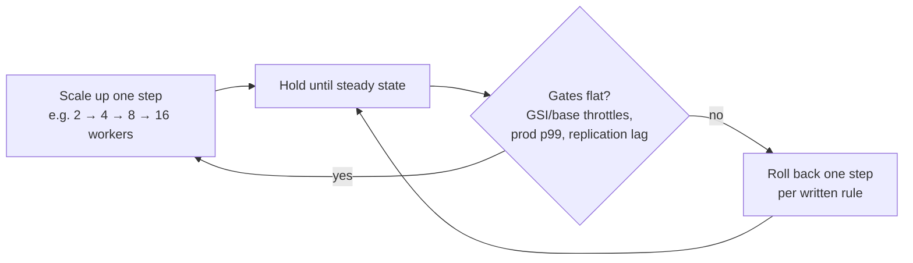
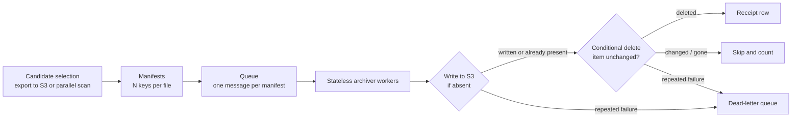

*All workloads and figures below are hypothetical and labeled as illustrative. Prices are AWS public list prices for US East (N. Virginia), checked October 13, 2026 (sources at the end).*

If you have run AWS's free DynamoDB Optima tool, or any cost explorer, you probably already know which tables are expensive. Finding the problem is the easy, free part. What is still mostly manual is the fix: moving cold items out of DynamoDB into S3 safely, at scale, without hurting live traffic and without losing data.

This post covers that fix. It is the method I use as an independent engineer, organized around the mistakes I see most often.

## 1. Your estimate is wrong before you start

The usual back-of-envelope math is table size × $0.25/GB-month. In my experience that understates the real storage bill by 3–5×, for two reasons:

- **Global secondary indexes are billed storage too.** A GSI with a wide projection (`ALL` or many `INCLUDE` attributes) is close to a second copy of the table.
- **Global tables bill a full copy per replica Region.** Three replicas means three times the storage, and every write is billed again as a replicated write in each Region.

**Illustrative example.** Picture a hypothetical `orders-events` table: about 10 TB of base data (10,240 GB), items averaging about 1 KB, two GSIs that together add 60% on top of the base, and three replica Regions.

| Estimate | Math | Monthly storage |
|---|---|---|
| Naive | 10,240 GB × $0.25 | **$2,560** |
| Real | 10,240 × 1.6 × 3 replicas × $0.25 | **$12,288** |

That's 4.8× the naive figure. So start from billing data, not from the console's table-size column. Enable the Cost and Usage Report (CUR) with resource IDs and group by table ARN and usage type (storage, write units, replicated write units, reads). That shows you where the money actually goes, and the gap is often surprising.

## 2. Pick the cutoff from data, not from a meeting

"Archive anything older than a year" sounds sensible until a late correction arrives for an 11-month-old order and finds the item missing.

Measure it instead. For a sample of items, compare each update's timestamp with the item's creation time. That gives you the distribution of how late changes actually arrive. Find the p99, look at the p99.9 and the maximum, then set the "final" age comfortably beyond the worst window you observed. If p99 is 40 days and the maximum is 120, a 180-day cutoff is defensible and a 30-day cutoff isn't.

In the example, say 75% of items are older than the cutoff. That's about 7.5 TB of base data, or roughly 8 billion 1 KB items.

## 3. Don't use TTL as your archive of record

TTL looks like free archival: set an expiry, let DynamoDB delete the item, catch the deletion on the stream, and copy it to S3. I avoid this for any data you can't afford to lose:

- **TTL deletes first.** The only remaining copy of the item lives in the stream record.
- **Stream records last 24 hours.** If your copier is down, throttled, or buggy for longer than that, those items are gone for good.
- **On multi-Region global tables, TTL can cost more, not less.** Setting the TTL attribute on existing items is itself a write, replicated to every Region and to any index that projects it. The expiry then replicates as a delete into the other Regions. Setting the attribute and then expiring it can use more write units than a single explicit delete.

The safer pattern is **archive first, then conditional delete**:

1. Write the item to S3 *only if no archived copy exists* (`If-None-Match: *` on PutObject, or check a manifest).
2. Delete it from DynamoDB *only if it still exists and is unchanged* (a `ConditionExpression` on the version or last-modified attribute).

Both steps are idempotent, so you can retry any batch safely. Every failure mode leaves the data in DynamoDB, which is the side you can recover from.

## 4. For small items, S3 Standard beats the "cheaper" classes

The instinct is to put archived data in Glacier Instant Retrieval at $0.004/GB-month instead of S3 Standard at $0.023. For roughly 1 KB objects, that's a trap. Standard-IA and Glacier IR **bill a minimum of 128 KB per object**. Glacier Flexible Retrieval and Deep Archive add **40 KB of metadata overhead per object**.

**Illustrative: 8 billion 1 KB items, one object per item.**

| Class | Billable size | Monthly storage | One-time PUTs |
|---|---|---|---|
| S3 Standard | ~7,630 GB | **~$176** | 8B × $0.005/1K = **$40,000** |
| Glacier IR | 8B × 128 KB ≈ 977,000 GB | **~$3,900** | 8B × $0.02/1K = **$160,000** |

Glacier IR comes out 22× more expensive to store and 4× more expensive to write. With small items, storage is cheap in any class and **the money is in PUT requests**.

The alternative is **batching**: pack about 1,000 items into one object (newline-delimited JSON or Parquet). That cuts PUTs by 1,000× (to about $40) and makes colder classes viable again. The trade-off is that single-item reads need an index (item key → object + offset), and per-item idempotency gets harder. I choose based on how the archive will be read. Rare single-item lookups favor one object per item. Bulk analytics favors batching.

## 5. Your throughput limit is probably a GSI, not the table

When you delete billions of items, every delete also writes to each GSI. A throttled GSI applies back-pressure to writes on the base table. That means **your backfill can throttle customer writes** even when the base table has plenty of headroom.

Scale your workers in gated steps:

- **Cap**: stay under about 80% of the most constrained index's write limit, which is usually the index with the hottest partition key.
- **Step**: add workers in increments (for example 2 → 4 → 8 → 16), then hold each level long enough to see a steady state.
- **Gate**: after each step, check GSI and base-table throttle events, p99 latency for production writes, and replication latency. Move up only if all of them are flat.
- **Rollback rule**: written down in advance, not improvised. For example: "any production throttling, or a p99 regression above X ms, drops us one step immediately."

Run the backfill off-peak if your traffic has a daily trough.

## 6. The pipeline shape

Here is the shape I've found boring and reliable:

Select candidates from an analytics copy (DynamoDB export to S3, at $0.10/GB) rather than by scanning production, if you can. Workers are stateless, so you can scale them up or down at any time.

Roll it out in stages:

1. **Canary, copy only.** Archive a small slice with deletes disabled.
2. **Byte-compare.** Read the archived objects back and compare them with the live items.
3. **Enable deletes on a small slice**, then reconcile counts.
4. **Ramp** through the gated steps described in section 5.

## 7. Verification: "succeeded" is not the same as "archived"

Queue metrics will tell you that messages were processed. They won't tell you that a run finished cleanly but wrote nothing because a filter was wrong. My checks:

- **Sampled before/after**: pick random keys before the run and confirm each is in S3 and absent from DynamoDB afterward.
- **Count reconciliation**: candidates = archived + skipped (changed or already gone) + dead-lettered. Any gap blocks the next run.
- **A receipt row per run**: run ID, manifest count, items archived, items deleted, bytes written, start and end times. An "archived 0" receipt should page someone.
- **Queue retention vs backlog**: if the backlog can grow older than the queue's message retention, messages expire silently. Alert well before that point.

## 8. Reads after archival: separate path or transparent fallback

Something will eventually ask for an archived item. There are two options:

- **Separate read path**: an explicit "archive lookup" endpoint. Callers know they're asking for history, latency expectations are clear, and the hot path stays simple. The cost is that callers have to change.
- **Transparent fallback**: on a DynamoDB miss, check S3. No caller changes are needed, but every legitimate miss now pays for an S3 GET, and a bug can quietly turn hot traffic into S3 traffic.

I lean toward a separate path, plus a short-lived fallback during migration with a metric on how often it fires.

## 9. Price the alternatives before you build

"Move it to a relational database" or "put it in the lakehouse" sound reasonable. Price them first. A managed relational store bills for provisioned instance hours and storage replicated across zones. A lakehouse bills for compute and adds its own operational load. In my experience it's easy to turn a storage cut into a net cost increase compared with plain S3 objects plus a small lookup index. Run the full monthly number for each option, including compute you'll leave running.

## 10. The ROI math

**One-time cost** = backfill write throughput (deletes × replicas × (1 + GSIs)) + S3 PUTs + candidate export
**Monthly net saving** = DynamoDB storage removed − new S3 storage
**Payback (months)** = one-time ÷ monthly net saving
**Return over N months** = (monthly net saving × N − one-time) ÷ one-time

**Worked example (illustrative, on-demand pricing):**

- Deletes: 8B items × 3 Regions × (1 base + 2 GSIs) = 72B write units × $0.625/M = **$45,000**
- S3 PUTs: 8B × $0.005/1K = **$40,000**
- Export: 10,240 GB × $0.10 = **$1,024**
- **One-time ≈ $86,000**
- Storage removed: 75% × $12,288 = $9,216/month. S3 Standard adds $176/month. **Net ≈ $9,040/month**
- **Payback ≈ 9.5 months. 36-month return ≈ (9,040 × 36 − 86,000) ÷ 86,000 ≈ 2.8×**

If you batch 1,000 items per object, the PUT line falls to about $40 and payback drops to about 5 months. Then the delete cost dominates, and that's where provisioned capacity during the backfill window can help.

## 11. The loop, and where AI agents fit

The whole method is a loop: **find** (Optima, CUR) → **calculate** (the formulas above) → **decide** (cutoff, storage class, read path) → **execute** (gated pipeline). The legwork used to take weeks of engineering time: billing queries, late-update analysis, cost models, runbooks. AI agents now make that legwork cheap. What doesn't change is that a human approves every production step: the canary, the first delete, and each ramp gate.

Optima tells you where the money is. This method is how you get it back.

Want a second pair of eyes on your DynamoDB bill? I'm doing 3 free teardowns — leave a comment below.

---

### Sources (checked October 13, 2026, us-east-1 list prices)
- [Amazon DynamoDB Pricing](https://aws.amazon.com/dynamodb/pricing/on-demand/)
- [S3 Pricing](https://aws.amazon.com/s3/pricing/) (storage classes, minimum object size, per-object overhead)
- [S3 price list API (us-east-1 offer, published October 12, 2026)](https://pricing.us-east-1.amazonaws.com/offers/v1.0/aws/AmazonS3/current/us-east-1/index.json)
